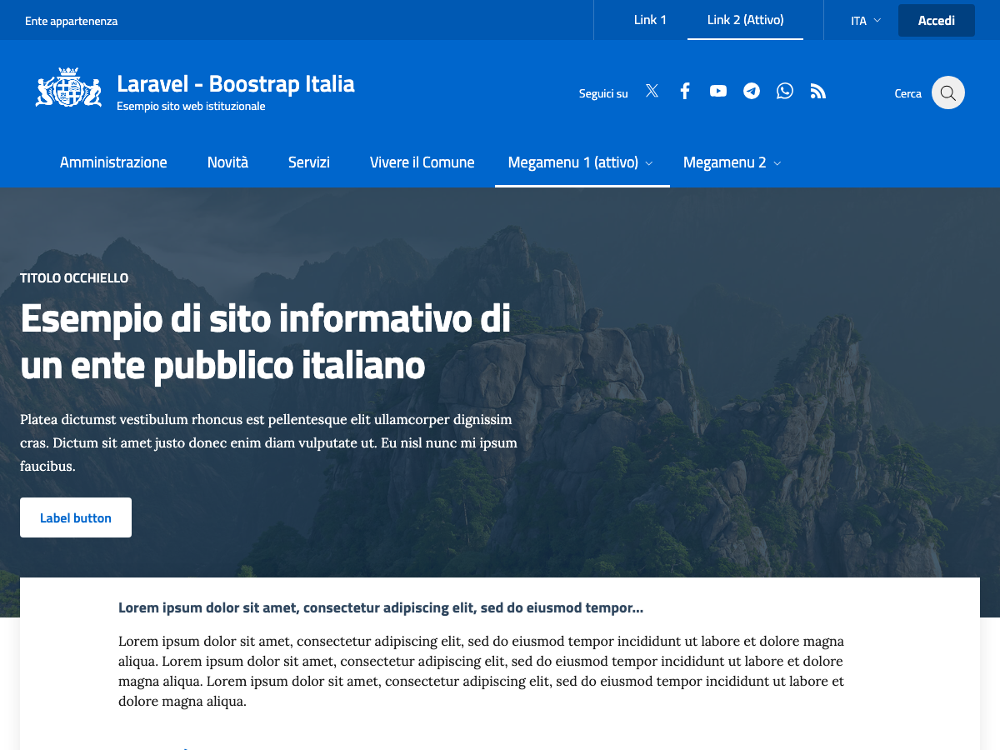

# Laravel Bootstrap Italia

A starter template for Italian public administration websites, built with Laravel and [Bootstrap Italia](https://italia.github.io/bootstrap-italia/), the official design system of the Italian government ("Designers Italia").
It provides an institutional home page layout and user authentication, ready to be extended.



## Features

- Institutional home page based on the Bootstrap Italia components: header with social links and search, megamenu navigation, hero, highlighted content, card carousel and footer
- User authentication (login, registration, password reset, email verification) with Laravel Breeze
- User profile page (update profile, change password, delete account)
- Bootstrap Italia assets (CSS, JS, fonts and SVG icons) served from `public/vendor/bootstrap-italia`

## Tech stack

- [Laravel 12](https://laravel.com/)
- PHP 8.2+
- [Bootstrap Italia 2](https://italia.github.io/bootstrap-italia/)
- [Vite](https://vite.dev/) and [Alpine.js](https://alpinejs.dev/)
- MySQL (or any database supported by Laravel)

## Getting started

### Requirements

- PHP 8.2 or later
- Composer
- Node.js 20 or later
- MySQL or MariaDB

### Installation

```bash
git clone https://github.com/davidebalice/laravel-bootstrap-italia.git
cd laravel-bootstrap-italia

composer install
npm install

cp .env.example .env
php artisan key:generate
```

Update the database settings in `.env`, then run the migrations:

```bash
php artisan migrate
```

A sample database dump is also available in `sql/laravel-bs-italia.sql`.

### Run

```bash
npm run build
php artisan serve
```

The website is available at `http://localhost:8000`.

To run the server, queue worker, logs and Vite dev server together during development:

```bash
composer run dev
```

### Updating Bootstrap Italia

Bootstrap Italia is installed with npm and its compiled files are copied to `public/vendor/bootstrap-italia`. After updating the package, copy the new files:

```bash
npm update bootstrap-italia
rm -rf public/vendor/bootstrap-italia
cp -R node_modules/bootstrap-italia/dist public/vendor/bootstrap-italia
```

## Author

**Davide Balice** – [davidebalice.dev](https://www.davidebalice.dev)
